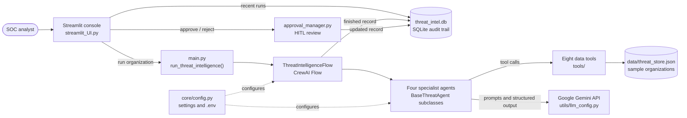

# Cybersecurity Threat Intelligence Platform

The Cybersecurity Threat Intelligence Platform runs four AI specialists in sequence to assess an organization's threat exposure, plan an incident response, and recommend security controls. A CrewAI Flow coordinates the agents, a criticality router sends critical incidents to a human SOC analyst for approval, and a Streamlit console presents each run.

## Overview

Security teams receive evidence from many systems at once: SIEM events, network intrusion detection alerts, endpoint telemetry, threat intelligence feeds, asset inventories, vulnerability scans, compliance benchmarks, and security posture audits. Reviewing these sources by hand is slow and inconsistent. This platform gathers them through deterministic data tools, asks a Google Gemini model to reason over the evidence, and produces one structured intelligence record per organization.

Each record contains a threat detection assessment, a threat analysis with attributed actors and attack patterns, an incident response plan with forensic findings, and a prioritized recommendation set with a roadmap and a written report. Every finished run is saved to a local SQLite audit trail.

## Key Features

The platform runs a four-stage agent pipeline where each stage reads the shared intelligence record and adds its results to it. A criticality router branches the flow based on the number of critical threats the analyst identifies, and critical runs pause for human review. Each agent returns structured output validated by Pydantic models, retries failed calls, and reports errors without stopping the rest of the pipeline. The Streamlit console shows the pipeline trace, KPIs, threats, response actions, recommendations, and recent run history.

## Architecture

### System Components

The diagram below shows how the console, the CrewAI Flow, the agents, the data tools, the Gemini API, and the SQLite audit trail connect. It renders on GitHub and other Markdown viewers that support Mermaid.



### Workflow

The workflow is a CrewAI Flow defined in `Project/flows/threat_intelligence_flow.py`. The diagram below shows the order of execution.

```
detect_threats            (@start)      Threat Detection agent
        |
analyze_threats           (@listen)     Threat Analysis agent
        |
route_by_criticality      (@router)     critical_threats >= critical_threat_floor ?
       /                          \
flag_priority_response    mark_standard_response
 (priority mode, HITL)     (standard mode, auto-complete)
       \                          /
respond_to_incidents      (or_)         Incident Response agent
        |
recommend_security        (@listen)     Security Recommendation agent
        |
finalize_intelligence     (@listen)     Set final status and save to SQLite
```

All steps share one dictionary called the intelligence record. The record is created by `create_intel_state()` in `core/state.py` and stored at `self.state["intel"]`. Each step updates the record and returns it. The router reads the record but does not modify it.

Routing works as follows. When the analyst's `critical_threats` value meets or exceeds `critical_threat_floor` (default 1), the run enters priority mode, sets `hitl.required` to true, and ends with the status `QUEUED_FOR_REVIEW`. Otherwise the run enters standard mode and ends with the status `COMPLETED`. The count comes from the language model's judgment. The code does not apply a severity formula.

## Agents

Each specialist subclasses `BaseThreatAgent` in `Project/agents/base_agent.py`. The base class builds a CrewAI agent with a role, goal, backstory, Gemini model, and tool list. Its `execute_async()` method retries failed analyses up to `max_retries` times, waits `retry_delay_seconds` between attempts, and never raises an exception. If every attempt fails, it returns a result with `status` set to `error`, and the flow records that error and continues.

The Threat Detection agent (`ThreatDetectionAgent`) uses the SIEM Event Monitor and Network Intrusion Detection Monitor tools. It identifies threats, assigns a threat severity score from 0 to 100, counts compromised systems, and sets a detected flag.

The Threat Analysis agent (`ThreatAnalysisAgent`) uses the Threat Intelligence Feed and Endpoint Detection and Response Telemetry tools. It attributes threats to actors, maps attack patterns, estimates business impact, and reports the critical threat count that drives routing.

The Incident Response agent (`IncidentResponseAgent`) uses the Asset Inventory System and Vulnerability Scanner tools. It produces a phased response plan with actions, priorities, and targets, lists forensic findings, and writes a containment summary.

The Security Recommendation agent (`SecurityRecommendationAgent`) uses the Compliance Framework Benchmark and Security Posture Audit tools. It maps findings to NIST CSF, CIS Controls, MITRE ATT&CK, ISO 27001, and SANS Top 20. It then produces prioritized recommendations, a roadmap with timeframe, effort, and return fields, a confidence value, a rationale, and a final Markdown report.

The tools in `Project/tools/` are deterministic. They read sample data from `data/threat_store.json` and do not call the language model. The model reasons only over their output.

## Human-in-the-Loop Review

Critical runs stop at `QUEUED_FOR_REVIEW`. The console then shows a warning and two buttons, Approve response and Reject response, with an optional reviewer note. The approval functions in `Project/human_intervention/approval_manager.py` set the decision to `APPROVED` or `REJECTED`, update the status to match, and save the record again. If the note is blank, the console records a default note stating that the SOC analyst approved or rejected the response.

The platform does not execute containment actions. An approved plan is a recommendation for the SOC team to carry out in its own tools.

## Project Structure

The application root is the `Project` folder. The top-level `README.md` sits one level above it.

```
workspace-main/
├── README.md
└── Project/
    ├── .env                                  GEMINI_API_KEY and GEMINI_MODEL (you create this file)
    ├── main.py                               Entry point: run_threat_intelligence() and console wiring
    ├── streamlit_UI.py                       Streamlit SOC console
    ├── requirements.txt
    ├── agents/
    │   ├── base_agent.py                     BaseThreatAgent: retries and error handling
    │   ├── threat_detection_agent.py
    │   ├── threat_analysis_agent.py
    │   ├── incident_response_agent.py
    │   └── security_recommendation_agent.py
    ├── core/
    │   ├── config.py                         Settings, shared constants, database schema
    │   └── state.py                          Intelligence record helpers
    ├── data/
    │   └── threat_store.json                 Sample organizations (input data)
    ├── flows/
    │   └── threat_intelligence_flow.py       CrewAI Flow and criticality router
    ├── human_intervention/
    │   └── approval_manager.py               Approve and reject functions for HITL
    ├── tasks/                                Task builders and Pydantic output schemas
    ├── tools/                                Eight deterministic data-provider tools
    └── utils/
        ├── database.py                       SQLite audit trail
        └── llm_config.py                     Gemini LLM factory
```

The application creates two items at runtime inside `Project`: `threat_intel.db`, the SQLite audit database, and `.crewai_storage/`, the CrewAI storage folder.

## Prerequisites

The platform requires Python 3.10 or later and a Google Gemini API key from Google AI Studio. Each run makes several calls to the Gemini API, so the machine needs network access to Google's API endpoints.

## Installation

Run the following commands from the workspace folder. The examples use Windows PowerShell.

```powershell
cd workspace-main\Project
python -m venv .venv
.venv\Scripts\activate
pip install -r requirements.txt
```

On macOS or Linux, activate the environment with `source .venv/bin/activate` and use `python3` in place of `python` if needed.

## Configuration

Create a file named `.env` in the `Project` folder with two values:

```
GEMINI_API_KEY=your-gemini-api-key
GEMINI_MODEL=gemini-3.1-flash-lite
```

`GEMINI_MODEL` is optional and defaults to `gemini-3.1-flash-lite`. `validate_config()` in `core/config.py` stops a run if the key is missing or begins with `your`, which catches an unedited template value. Do not commit the `.env` file or share the key.

The other settings live in `core/config.py` and rarely need to change:

```
max_retries               3       Attempts per agent before it reports an error
retry_delay_seconds       2       Seconds to wait between attempts
critical_threat_floor     1       Critical threat count that triggers priority mode and HITL
data_dir                  Project/data
db_file                   Project/threat_intel.db
```

The language model settings come from `utils/llm_config.py`. Each agent uses a temperature of 0.2 and a maximum of 2000 output tokens unless its code sets different values.

## Running the Application

Start the Streamlit console from the `Project` folder:

```powershell
cd workspace-main\Project
python -m streamlit run main.py
```

Streamlit prints a local address, normally `http://localhost:8501`. Open that address in a browser.

## Using the Console

The sidebar lists the organizations in `data/threat_store.json`. Select one and choose Run threat intelligence. The console shows a spinner while the flow calls Gemini. A run can take a while because it makes several sequential model calls.

When the run finishes, the main area shows the organization name and response mode, a status banner, and four KPI tiles for threat severity, critical threats, compromised systems, and recommendation count with confidence. A pipeline trace lists the four stages with their durations. Four tabs hold the details: Report for the rationale and final report, Threats for detected threats, actors, attack patterns, and business impact, Response for the containment summary, actions, and forensic findings, and Recommendations for prioritized controls and the roadmap. The sidebar also lists the ten most recent runs.

## Sample Data

`Project/data/threat_store.json` holds a `description` field and an `organizations` object with 14 sample organizations, including Meridian Health Systems, Cascade Financial Group, and Volt Grid Energy. Each organization contains ten sections: `organization`, `profile`, `siem`, `network_ids`, `threat_feed`, `endpoint`, `asset_inventory`, `vuln_scan`, `compliance`, and `posture`. The organization names in the sidebar come from the keys of this object.

To add an organization, copy the structure of an existing entry and give it a new key. The tools look up records by that key, so the names must match exactly.

## Audit Trail

The `record_intel()` function in `utils/database.py` writes each finished or reviewed run to the `threat_intelligence` table in `threat_intel.db`. The table stores the main fields as columns, such as status, response mode, severity, and timestamps, along with the full record as JSON. Writes use `INSERT OR REPLACE` keyed on `record_id`, so an approval or rejection updates the existing row. `list_intel()` returns the most recent records for the console history.

## Extending the Platform

To add a data source, create a function decorated with `@tool` from `crewai.tools` in `tools/`, export it from `tools/__init__.py`, and add it to the tool list of the agent that needs it. Keep the tool deterministic, and have it read from the data layer rather than call the model.

To add a specialist, subclass `BaseThreatAgent`, implement `analyze_async()` so it returns a dictionary, and wire the agent into `ThreatIntelligenceFlow` with a new step. Add any new output fields to `core/state.py` so the record keeps a consistent shape.

## Testing

`requirements.txt` includes pytest, and the flow's router is written so that it can be called directly in unit tests. This copy of the project does not include a test directory. Add tests under a `tests` folder in `Project` and run them with `python -m pytest`.

## Troubleshooting

If the console reports that GEMINI_API_KEY is missing, confirm that the `.env` file sits in the `Project` folder, contains a real key, and that the Streamlit process was restarted after the change.

If the sidebar shows no organizations, confirm that `data/threat_store.json` exists and that Streamlit was started from the `Project` folder.

If the status banner lists agent errors, read the message in the banner. Quota limits, an invalid key, or a network failure from the Gemini API are the most likely causes. Each agent already retries up to three times before it reports an error.

The import order in `main.py` and `streamlit_UI.py` is intentional. `core.config` must load before any CrewAI import so that telemetry and tracing settings take effect. Do not move those imports above `core.config`.

## Known Limitations

The data tools read sample JSON and do not connect to live SIEM, EDR, or scanner systems. Model output is advisory and should be reviewed by a security analyst before any action is taken. The pipeline trace looks up stages by short keys such as `detector`, but the agents store their results under class names such as `ThreatDetectionAgent`, so the trace can show stages as not run even when they completed. The console has no authentication and the SQLite database is local to the machine, so the platform suits a single analyst workstation rather than a shared deployment.
